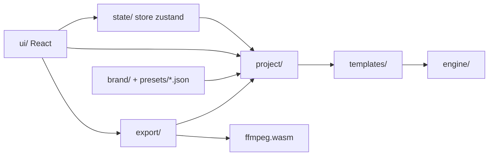

# Architecture

## Vue d'ensemble

- **Aucun serveur.** Le site est statique (GitHub Pages). Les créations sont dans le `localStorage` du
  navigateur ; le partage passe par des fichiers (`.dstudio.json`, kit `.json`) et par `presets/` dans le dépôt.
- **Un seul moteur de rendu pour l'aperçu et l'export.** `renderProjectFrame()` (aperçu, toute la timeline)
  et `renderItemFrame()` (export, un élément) appellent le même `template.render()` : ce qu'on voit est ce
  qu'on exporte, à la résolution près.

## Le rendu

Un modèle reçoit un `RenderContext` : contexte canvas, taille, `unit` (échelle), temps local, durée, style,
animation, logo. Il dessine **une image** pour cet instant. Le temps est découpé ainsi :

- `elementProgress(t, durée, délai, vitesse)` → 0 → 1 (entrée), 1 (maintien), 1 → 0 (sortie) ;
- chaque élément (étiquette, titre, sous-titre…) a un petit délai : c'est l'effet « en cascade » ;
- `withAnimation()` applique l'animation choisie (glissement, montée, rideau, pop, fondu) à partir de ce progrès.

Les modèles « liste » (série de chapitres, synthés en lot) transforment leur texte en plusieurs `items` ;
l'aperçu les enchaîne, l'export en fait un fichier chacun (ou un seul fichier enchaîné).

## L'export

1. `planExport()` décide du codec (selon logiciel + fond), des noms de fichiers et s'il faut un .zip.
2. Chaque image est dessinée sur un `OffscreenCanvas` à la résolution finale (1920×1080, 1080×1920…),
   encodée en PNG.
3. ffmpeg.wasm (copié dans `public/ffmpeg/` à l'installation, servi par le site) assemble les PNG :
   - MOV ProRes 4444 `yuva444p10le` (transparence 10 bits) ;
   - WebM VP8 `yuva420p` (VP9 plante faute de mémoire dans ffmpeg.wasm en 1080p) ;
   - MP4 H.264 pour les fonds opaques.
4. Plusieurs fichiers ou PNG → zip (fflate, sans recompression pour les vidéos).

Le rendu image par image (et non l'enregistrement en temps réel du simulateur d'origine) garantit une
animation parfaite même sur un ordinateur lent.

## L'état

`state/store.ts` (zustand + `persist`) contient les créations, le kit, les préférences d'export et d'interface.
Annuler / rétablir garde les 100 dernières versions de la création ouverte ; les frappes rapprochées dans un
même champ comptent pour une seule étape. Au chargement, tout ce qui vient du `localStorage` repasse par
`parseProject()` / `parseBrandKit()`.

## Tests

| Niveau             | Où                                 | Quoi                                                                                       |
| ------------------ | ---------------------------------- | ------------------------------------------------------------------------------------------ |
| Unitaires          | `src/**/*.test.ts` (Vitest, jsdom) | moteur, modèles (avec un faux canvas qui enregistre les textes), validation, export, store |
| Parcours           | `e2e/app.spec.ts` (Playwright)     | accueil → éditeur → étapes → annuler → rechargement                                        |
| Rendu de référence | `e2e/render.spec.ts`               | chaque modèle comparé à une image de `e2e/__screenshots__/`                                |
| Export réel        | `e2e/export.spec.ts`               | fichiers MOV / WebM / MP4 / ZIP valides, téléchargement                                    |
